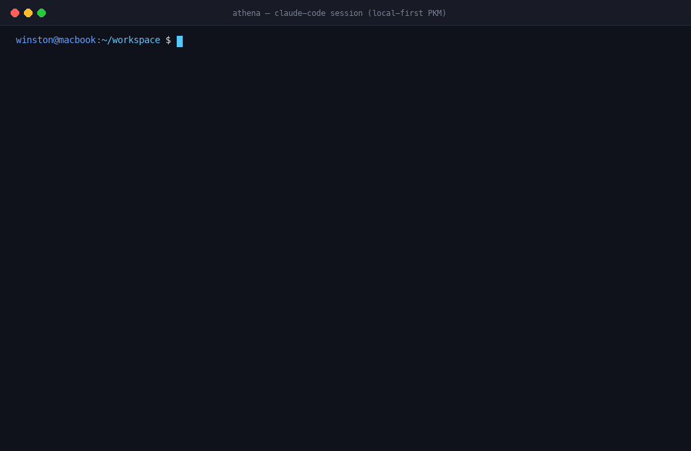

<div align="center">

# Athena

**Local-first memory, decision engine, and governance harness for AI agents — portable across any IDE.**

**Own the state. Rent the intelligence.** Persistent memory, structured reasoning,
and governed AI agents that work across any LLM — stored as plain Markdown and JSONL
on your disk across Claude Code, Antigravity, Cursor, Gemini CLI, and VS Code.

[](https://github.com/winstonkoh87/Athena-Public/actions/workflows/ci.yml)
[](https://pypi.org/project/athena-agent/)
[](LICENSE)
[](https://github.com/winstonkoh87/Athena-Public/stargazers)



[Quickstart](#quickstart) · [How It Works](#how-it-works) · [Structure](#repository-structure) · [SDK & MCP Tools](#what-ships-in-the-sdk) · [Docs](docs/GETTING_STARTED.md) · [Why Athena?](docs/WHY_ATHENA.md) · [Safety](SAFETY.md)

</div>

---

## The Problem: Stateless AI is an Amnesiac Bottleneck

Why do AI coding assistants still give generic, textbook answers? **Because frontier LLMs are fundamentally stateless.**

Every time you open a new session, the model starts from zero. It has no memory of your architecture, your past post-mortems, your risk tolerance, or your code invariants. To get useful work done, you are forced to pay an **Amnesia Tax** — spending 10 minutes writing prompt essays explaining your stack and constraints. Worse, platform memory is designed to agree with you faster (sycophancy), not to stress-test your assumptions when stakes are high.

Athena solves this by separating **intelligence** (the rented model) from **state** (your sovereign disk):

| Dimension | Stateless Chatbots (Rented RAM) | Stateful Agent with Athena (Owned Hard Drive) |
|:---|:---|:---|
| **Memory & Context** | Amnesiac: starts from zero; 10-minute prompt prep tax | Continuous: `/start` restores active tasks & invariants in ~3.6K tokens and <1s via batched `boot_status.py` |
| **Response Depth** | Generic median: broad consensus advice & textbook platitudes | Hyper-nuanced: conditioned on your real stack, balance sheet, & past post-mortems |
| **Alignment & Rigor** | Sycophantic: agrees with whatever you say, validating bad ideas | Governed: Law #1 blocks ruin; consigliere flags repeated blind spots |
| **Data Sovereignty** | Vendor lock-in: cloud database fees, wiped on API deprecation | 100% Sovereign: local Git-tracked Markdown & SQLite on your machine |
| **Model Agility** | Trapped in one chat platform | Portable: switch between Claude Code, Antigravity, Gemini, or Ollama instantly |

Athena moves the **memory, problem-framing, and decision layer to your machine**: plain Markdown and JSONL ledgers that you own, git-version, and mount into any IDE. The model is just whoever's on shift.

## Quickstart

```bash
git clone https://github.com/winstonkoh87/Athena-Public.git && cd Athena-Public
python3 -m venv .venv && source .venv/bin/activate
pip install -e ".[local]"               # lightweight — no cloud deps
athena init --ide claude                # or: antigravity, cursor, gemini, vscode, kilocode, roocode
athena doctor                           # expect 0 failures
```

Then type `/start` in your IDE's AI chat panel. Work normally. Type `/end` to save.

> **Full install** (cloud sync + cross-encoder reranking): `pip install -e ".[full]"`
> See [Getting Started](docs/GETTING_STARTED.md) for Windows, advanced config, and Supabase setup.

## How It Works

```text
┌─────────────────────────────────────────────────────────────────────────┐
│  Your IDE (Claude Code / Antigravity / Cursor / Gemini / VS Code)       │
└───────────────────────────────┬─────────────────────────────────────────┘
                                │ MCP Servers (19 Athena + 5 DuckDB tools) + Hooks
                                ▼
┌─────────────────────────────────────────────────────────────────────────┐
│  Athena SDK (src/athena/)                                               │
│  ├── 1. Memory & Hybrid RAG: /start (~3.6K boot), 5-channel parallel    │
│  │      RRF search, speculative "auto" local+ONNX fast-path, SQLite     │
│  │      search_cache_vecs.db                                            │
│  ├── 2. Problem Framing: VOI (EVI) calculator, falsifier & R1-R13       │
│  │      commitment gates (frame_ledger.py)                              │
│  ├── 3. Decision, Wargaming & OSINT: EEV, 1/3 Kelly, Ruin, MCDA         │
│  │      (gto_engine.py), 2-turn Wargame (wargame.py), UCDS OSINT        │
│  │      (ucds_validator.py)                                             │
│  └── 4. Governance & Telemetry: Lambda risk router, Law #1 ruin blocker,│
│         Trade Guardian (trade_guardian.py), O(1) 64KB JSONL tail gates  │
│         (jsonl_tail.py)                                                 │
└───────────────────────────────┬─────────────────────────────────────────┘
                                │
                                ▼
┌─────────────────────────────────────────────────────────────────────────┐
│  Your Disk (Plain Markdown + SQLite/JSONL receipts — git-native)        │
│  └── Optional: Supabase pgvector (cloud sync) + DuckDB (analytics)      │
└─────────────────────────────────────────────────────────────────────────┘
```

**Three operating modes, one compounding loop:**

| Mode | Lifecycle | Token Budget | Retrieval & Compute Strategy |
|:-----|:----------|:-------------|:-----------------------------|
| **Sniper** (`SNIPER`, `Lambda < 10`) | Direct chat -> `/end` | ~500 tokens | `vector_mode="local"` (<50 ms local FTS5/lex/canonical, zero cloud RTT) |
| **MinMax v2.0 (Default)** (`STANDARD`, `Lambda 10–30`) | `/start` -> work -> `/end` | ~3.6K boot tokens (`14.5 KB`, `-78.1%`) | `<1.0s` concurrent `scripts/boot_status.py`; speculative `"auto"` local+ONNX fast-path (`Lambda 10–14`) escalating to `"always"` hybrid vector+rerank (`Lambda >= 15`) |
| **MaxMax v4.0 (Curated Compute)** (`ULTRA`, `Lambda > 30`) | `/ultrastart` -> `/ultrathink` -> `/ultraend` | `<= 40K` boot ceiling (`< 20%` of 200K ECL) | Surgical canonical/project slice loading (~145K+ tokens reserved for multi-track synthesis), 3-query parallel adversarial Exocortex pre-warming, and 3-mode `/ultrathink` orchestration (Native Swarm / API / HITL) |

## Repository Structure

Following Protocol 543 clean-lobby repository layout:

```text
Athena-Public/
├── src/athena/          # Core runtime (Memory, Intelligence/GTO, Governance, Lifecycle, Tools)
├── tests/               # Test suites (unit, integration, red-team, MinMax/MaxMax regression)
├── scripts/             # Batched boot, shutdown hygiene, benchmarks, and sync verification
├── docs/                # Architecture, guides, wiki mirror, roadmap, benchmarks, and specs
├── examples/            # Reference workflows, skills, protocols, scripts, templates, and demos/
├── supabase/            # Database schemas, migrations, edge functions, and vector RPCs
├── docker/              # Sandboxed container environments
├── data/                # Active datasets and public asset staging
├── .agent/              # Shipped agent workflows, hooks, scripts, and canonical config
├── .context/            # Workspace state templates, protocol summaries, and canonical view
├── .framework/          # Reference framework modules and legacy compatibility specs
├── .github/             # Workflows, CI scripts, security/contributing/support/CoC policies
├── AGENTS.md            # Root agent entrypoint (symlinked by CLAUDE.md)
├── ARCHITECTURE.md      # Narrative system architecture and memory layout
├── DATA_CONTRACT.md     # Authoritative read/write boundary specification
├── SAFETY.md            # Risk boundaries and crisis/harm safeguards
├── CHANGELOG.md         # Root pointer to docs/CHANGELOG.md
├── athena.yaml          # Machine-readable agent capability manifest
├── llms.txt             # LLM-friendly index of public docs and specs
├── pyproject.toml       # Package metadata, dependencies, and tool configuration
├── Makefile             # Standard task runner (install, test, lint, typecheck, privacy-check)
├── LICENSE              # MIT License
└── README.md            # Project front door
```

## What Ships in the SDK

Athena is not just a prompt pack — it ships executable Python engines and two Model Context Protocol (MCP) servers (`athena.mcp_server` and `athena.duckdb_mcp_server`):

| Subsystem | Module / MCP Tool | What It Computes / Enforces |
|:----------|:------------------|:----------------------------|
| **Hybrid RAG & Speculative Context Gate** | `mcp_server.py` (`smart_search`, `context_gate`), `tools/search.py`, `core/cache.py` | Concurrent 5-channel RRF fusion (BM25 FTS5 + pgvector + filename headers + canonical/graph + ONNX cross-encoder rerank), `"local"`/`"auto"`/`"always"` vector routing, and zero-write-on-hit SQLite `search_cache_vecs.db` |
| **Problem Framing & VOI Ledger** | `intelligence/frame_ledger.py` (`frame_open`, `frame_validate`, `frame_resolve`, `frame_status`) | Value of Information (`EVI`) stop-rule, falsifiable hypothesis pre-registration, `R1–R13` commitment gates (loop budget, surviving contingency branch, irreversible ruin check), `LUCK` outcome-band gate, and Brier calibration scoring |
| **Quantitative Decision Engine** | `intelligence/gto_engine.py` (`decision_screen`) | Deterministic evaluators for Expected Economic Value (`eev`), One-Third Kelly (`kelly`), Absorbing-Barrier Ruin (`ruin`), MCDA with ruin vetoes (`mcda`), Decision Monte Carlo (`decision-mc`), Scenario Robustness (`robustness`), Barbell (`barbell`), and SHA-256 receipts (`.athena/decision_receipts.jsonl`) |
| **Adversarial Wargaming Engine** | `intelligence/wargame.py` (`athena-wargame`) | Two-turn sequential Blue vs. Red game trees with intra-turn path-dependent trough ruin, Red best-response optimization, and tamper-evident run receipts (`.athena/wargame_runs.jsonl`) |
| **Counterparty OSINT & Trade Governance** | `intelligence/ucds_validator.py`, `tools/trade_guardian.py` | Deterministic Universal Counterparty Dossier Standard (`audit_ucds_dossier`) validator (Track A/B bifurcation, knockout gates, cashflow inversion) plus position/drawdown/sizing safety guards |
| **Local Analytical SQL** | `duckdb_mcp_server.py` (`query`, `profile`, `list_tables`, `export_result`) | Zero-dependency DuckDB engine for profiling and querying large CSV, JSON, and Parquet datasets without exhausting LLM context windows |
| **Runtime Governance & Batched Telemetry** | `core/governance.py`, `scripts/boot_status.py`, `.agent/scripts/hook_*.py`, `.agent/scripts/lib/jsonl_tail.py` | Concurrent `<1.0s` boot status, `O(1)` 64KB EOF tail verification gates, capability permissions, Protocol 509 crisis safety screen, 14/16 destructive command blocker, and secret egress scanner |

### What's enforced in code vs. by prompt

> *Most AI-agent READMEs state every claim in the same confident voice. This one doesn't.*

| Claim | Status | Evidence |
|:------|:-------|:---------|
| **Storage & hybrid retrieval** — memories stored and surfaced when relevant | ✅ Shipped (`code-enforced`) | Hybrid RAG with document-level RRF + cross-encoder rerank, hardened through [logged regressions](docs/CHANGELOG.md) |
| **Portability** — Markdown and JSONL on your disk, movable across models | ✅ Shipped (`structural`) | Plain files on disk — inspect the repo |
| **Quantitative decision screening & wargaming** — EEV, 1/3 Kelly, Ruin, MCDA, 2-turn game trees | ✅ Shipped (`code-available`) | [`gto_engine.py`](src/athena/intelligence/gto_engine.py) & [`wargame.py`](src/athena/intelligence/wargame.py) emit SHA-256 receipts (`107` tests); Stop hook blocks unreceipted numeric engine claims |
| **Pre-registered problem framing** — VOI stop-rule, `R1–R13` commitment & falsifier gates | ✅ Shipped (`code-available`) | [`frame_ledger.py`](src/athena/intelligence/frame_ledger.py) validates falsifiers, loop budgets, and Brier calibration (`57` tests) |
| **Governed autonomy** — hooks block destructive commands, ungrounded claims, and secrets | ✅ Shipped (partial) | Ruin check blocks 14/16 destructive commands; 2 shell bypasses are [known and tracked](docs/TECH_DEBT.md) |
| **Compounding personalization** — session 2,000 recalls session 5 | 🟡 N=1 evidence | 2,100+ sessions, 410 active protocols, and 629 case studies by the author; no multi-user study |
| **Anti-sycophancy** — personalization doesn't silently increase agreement | 🟡 Partial mitigation | Code-enforced meta-awareness gate (Claude Code hook); agent-discretion in hookless IDEs — see [honest limits](docs/ENGINEERING_DEPTH.md) |

> **Why publish this table?** Because the failure mode of this product category is self-mythologizing — describing aspirations in the present tense. Athena's own convention ([Epistemic Status](examples/workflows/references/_shared_extended.md#1-epistemic-status-convention-s534--anti-self-mythologizing)) requires labeling every mechanism as `code-enforced`, `code-available`, `agent-discretion`, or `aspirational`. This table is that convention applied to the README.

## Measured, Not Claimed

```bash
# Run the batched boot status check (<1.0s concurrent telemetry + index health)
python3 scripts/boot_status.py --json

# Run the test suite (including frame_ledger, gto_engine, and MinMax/MaxMax suites)
pytest tests/ -v --tb=short

# Screen a decision quantitatively (EEV / 1/3 Kelly / Ruin / MCDA / Monte Carlo)
python -m athena.intelligence.gto_engine --action mcda --help

# Adjudicate a 2-turn adversarial wargame with path-dependent trough ruin screening
python -m athena.intelligence.wargame --help

# Validate a pre-registered problem frame against R1-R13 commitment gates
python -m athena.intelligence.frame_ledger calibrate

# Run the local KV cache & TTFT benchmark (Ollama / llama.cpp)
python scripts/benchmark_kv_cache.py --model qwen2.5-coder:14b

# Run the retrieval evaluator yourself (requires Supabase keys + golden_queries.json)
python examples/scripts/evaluator.py --k 5 --rerank
```

| Metric | Value | Verification Command |
|:-------|:------|:---------------------|
| **MinMax v2.0 Boot & Warm Gate Latency** | **< 1.0s boot status / < 10 ms warm `context_gate` hit** | `pytest tests/test_minmax_remediation.py -v` |
| **Local TTFT Scaling (2K Boot)** | **~35x–50x speedup vs 32K** | `python scripts/benchmark_kv_cache.py` |
| **Retrieval Hit@5 (Strict)** | **0.569** (37 / 65) | `python examples/scripts/evaluator.py` |
| **Retrieval MRR@5 (Strict)** | **0.472** | `python examples/scripts/evaluator.py` |
| *Retrieval Hit@5 (Lenient)* | *0.892 (deprecated)* | *Partial substring match (inflated)* |
| **Unit & Red-Team Tests** | **750+ passed (100%)** | `pytest tests/` |
| **Secret Leaks (1,248+ commits)** | **0 detected** | Gitleaks + `privacy_scan.py` in CI |
| **Code Quality & Lints** | **0 ruff findings** | `ruff check src/ scripts/ tests/` |

> **Anti-Goodhart Invariant**: Why did our reported Hit@5 shift from 0.89 to 0.57? Lenient substring matchers count partial word overlaps as "hits," inflating benchmark scores by ~36% without improving retrieval. We killed the lenient matcher because vanity metrics mask regressions. See the full breakdown: [Anti-Goodhart Benchmarking in RAG](docs/BENCHMARKS.md#the-anti-goodhart-shift-why-we-published-lower-numbers).

## Agent Compatibility

| IDE | Config file | Tested |
|:----|:------------|:-------|
| Claude Code | `CLAUDE.md` | ✅ |
| Antigravity | `AGENTS.md` | ✅ |
| Cursor | `.cursor/rules.md` | ✅ |
| Gemini CLI | `.gemini/AGENTS.md` | ✅ |
| VS Code + Copilot | `.vscode/settings.json` | ✅ |
| Kilo Code | `.kilocode/rules/athena.md` | ✅ |
| Roo Code | `.roo/rules/athena.md` | ✅ |

## Documentation

| Doc | What it covers |
|:----|:---------------|
| [Getting Started](docs/GETTING_STARTED.md) | Install, configure, first session |
| [Your First Session](docs/YOUR_FIRST_SESSION.md) | 20-minute guided tutorial |
| [How It Works](docs/ARCHITECTURE.md) | 4-pillar architecture, search pipeline, and decision gates |
| [Why Athena?](docs/WHY_ATHENA.md) | Philosophy, problem classification, use cases, cost analysis |
| [Engineering Depth](docs/ENGINEERING_DEPTH.md) | Technical deep dives and honest limits |
| [CLI Reference](docs/CLI.md) | All commands |
| [FAQ](docs/FAQ.md) | Common questions |
| [Safety](SAFETY.md) | Limitations and responsible use |
| [Changelog](docs/CHANGELOG.md) | Release history |

## Contributing

PRs welcome. Please read [CONTRIBUTING.md](.github/CONTRIBUTING.md) first.

The codebase uses `ruff` for linting, `pytest` for tests, and CI must pass before merge (`make check-all`).

---

<div align="center">

**MIT License** · [Contributing](.github/CONTRIBUTING.md) · [Safety](SAFETY.md) · [Security Policy](.github/SECURITY.md) · [Security Model](docs/SECURITY.md) · [Code of Conduct](.github/CODE_OF_CONDUCT.md) · [Support](.github/SUPPORT.md) · [Accessibility](.github/ACCESSIBILITY.md)

Built and battle-tested solo across 2,100+ sessions by [Winston Koh](https://winstonkoh87.com).

*Clone it. Boot it. Make it yours.*

</div>
