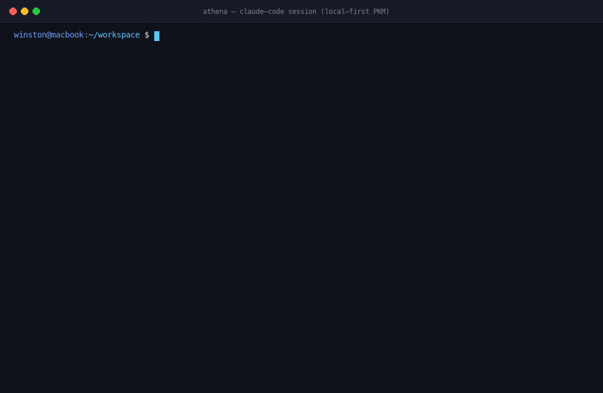

<div align="center">

# Athena

**A local-first memory, decision engine, and governance harness for AI agents — portable across IDEs.**

**Own the state. Rent the intelligence.** Persistent memory, structured reasoning,
and governed AI agents that work across any LLM — stored as plain Markdown and JSONL
on your disk across Claude Code, Antigravity, Cursor, Gemini CLI, and VS Code.

[](https://github.com/winstonkoh87/Athena-Public/actions/workflows/ci.yml)
[](https://pypi.org/project/athena-agent/)
[](LICENSE)
[](https://github.com/winstonkoh87/Athena-Public/stargazers)



[Quickstart](#quickstart) · [How It Works](#how-it-works) · [SDK & MCP Tools](#what-ships-in-the-sdk) · [Docs](docs/GETTING_STARTED.md) · [Why Athena?](docs/WHY_ATHENA.md) · [Safety](SAFETY.md)

</div>

---

## The Problem

You've spent months training ChatGPT to understand you. Then a model update resets the personality. You switch to Claude or Gemini — you start from zero. Worse, platform memory is designed to agree with you faster, not to stress-test your assumptions when stakes are high.

Athena moves the **memory, problem-framing, and decision layer to your machine**: plain Markdown and JSONL ledgers that you own, git-version, and mount into any IDE. The model is just whoever's on shift.

## Quickstart

```bash
git clone https://github.com/winstonkoh87/Athena-Public.git && cd Athena-Public
python3 -m venv .venv && source .venv/bin/activate
pip install -e ".[local]"               # lightweight — no cloud deps
athena init --ide claude                # or: antigravity, cursor, gemini, vscode, kilocode, roocode
athena doctor                           # expect 0 failures
```

Then type `/start` in your IDE's AI chat panel. Work normally. Type `/end` to save.

> **Full install** (cloud sync + cross-encoder reranking): `pip install -e ".[full]"`
> See [Getting Started](docs/GETTING_STARTED.md) for Windows, advanced config, and Supabase setup.

## How It Works

```text
┌───────────────────────────────────────────────────────────────────┐
│  Your IDE (Claude Code / Antigravity / Cursor / Gemini / VS Code) │
└───────────────────────────────┬───────────────────────────────────┘
                                │ MCP Server (18 tools) + Lifecycle Hooks
                                ▼
┌───────────────────────────────────────────────────────────────────┐
│  Athena SDK (src/athena/)                                         │
│  ├── 1. Memory & RAG: /start (~2K boot), hybrid search + reranker │
│  ├── 2. Problem Framing: VOI calculator, falsifier & R1-R13 gates │
│  ├── 3. Decision Engine: EEV, 1/3 Kelly, Ruin, MCDA, Monte Carlo  │
│  └── 4. Governance: Lambda risk router, ruin blocker, secret scan │
└───────────────────────────────┬───────────────────────────────────┘
                                │
                                ▼
┌───────────────────────────────────────────────────────────────────┐
│  Your Disk (Plain Markdown + JSONL receipts/ledgers — git-native) │
│  └── Optional: Supabase pgvector (cloud sync) + DuckDB (analytics)│
└───────────────────────────────────────────────────────────────────┘
```

**Three boot modes, one compounding loop:**

| Mode | Boot | Token Cost | When |
|:-----|:-----|:-----------|:-----|
| Lightweight | Just chat, then `/end` | ~500 | Quick questions (`SNIPER`, Lambda < 10) |
| Standard | `/start` → work → `/end` | ~2K–10K | Daily engineering & analysis (`STANDARD`, Lambda 10–30) |
| Deep | `/ultrastart` → work → `/ultraend` | ~20K | High-stakes strategy & architecture (`ULTRA`, Lambda > 30) |

## What Ships in the SDK

Athena is not just a prompt pack — it ships executable Python engines and two Model Context Protocol (MCP) servers (`athena.mcp_server` and `athena.duckdb_mcp_server`):

| Subsystem | Module / MCP Tool | What It Computes / Enforces |
|:----------|:------------------|:----------------------------|
| **Hybrid RAG & Context Gate** | `mcp_server.py` (`smart_search`, `context_gate`) | Document-level RRF fusion across BM25 FTS5 + pgvector + filename headers + ONNX cross-encoder rerank; Lambda risk-tier routing (`SNIPER` / `STANDARD` / `ULTRA`) |
| **Problem Framing & VOI Ledger** | `intelligence/frame_ledger.py` (`frame_open`, `frame_validate`, `frame_resolve`, `frame_status`) | Value of Information (`EVI`) stop-rule, falsifiable hypothesis pre-registration, `R1–R13` commitment gates (loop budget, surviving contingency branch, irreversible ruin check), `LUCK` outcome-band gate, and Brier calibration scoring |
| **Quantitative Decision Engine** | `intelligence/gto_engine.py` (`decision_screen`) | Deterministic evaluators for Expected Economic Value (`eev`), One-Third Kelly (`kelly`), Absorbing-Barrier Ruin (`ruin`), MCDA with ruin vetoes (`mcda`), Decision Monte Carlo (`decision-mc`), Scenario Robustness (`robustness`), Barbell (`barbell`), and SHA-256 receipts (`.athena/decision_receipts.jsonl`) |
| **Local Analytical SQL** | `duckdb_mcp_server.py` (`query`, `profile`, `list_tables`, `export_result`) | Zero-dependency DuckDB engine for profiling and querying large CSV, JSON, and Parquet datasets without exhausting LLM context windows |
| **Runtime Governance & Safety** | `core/governance.py`, `core/permissions.py`, `.agent/scripts/hook_*.py` | Capability permission gates, Protocol 509 crisis safety screen, 14/16 destructive command blocker, secret egress scanner, and Doom-Loop circuit breaker |

### What's enforced in code vs. by prompt

> *Most AI-agent READMEs state every claim in the same confident voice. This one doesn't.*

| Claim | Status | Evidence |
|:------|:-------|:---------|
| **Storage & hybrid retrieval** — memories stored and surfaced when relevant | ✅ Shipped (`code-enforced`) | Hybrid RAG with document-level RRF + cross-encoder rerank, hardened through [logged regressions](docs/CHANGELOG.md) |
| **Portability** — Markdown and JSONL on your disk, movable across models | ✅ Shipped (`structural`) | Plain files on disk — inspect the repo |
| **Quantitative decision screening** — EEV, 1/3 Kelly, Ruin, MCDA, Monte Carlo | ✅ Shipped (`code-available`) | [`gto_engine.py`](src/athena/intelligence/gto_engine.py) emits SHA-256 receipts (`107` tests); Stop hook blocks unreceipted numeric engine claims |
| **Pre-registered problem framing** — VOI stop-rule, `R1–R13` commitment & falsifier gates | ✅ Shipped (`code-available`) | [`frame_ledger.py`](src/athena/intelligence/frame_ledger.py) validates falsifiers, loop budgets, and Brier calibration (`57` tests) |
| **Governed autonomy** — hooks block destructive commands, ungrounded claims, and secrets | ✅ Shipped (partial) | Ruin check blocks 14/16 destructive commands; 2 shell bypasses are [known and tracked](docs/TECH_DEBT.md) |
| **Compounding personalization** — session 2,000 recalls session 5 | 🟡 N=1 evidence | 2,100+ sessions, 427 active protocols, and 594 case studies by the author; no multi-user study |
| **Anti-sycophancy** — personalization doesn't silently increase agreement | 🟡 Partial mitigation | Code-enforced meta-awareness gate (Claude Code hook); agent-discretion in hookless IDEs — see [honest limits](docs/ENGINEERING_DEPTH.md) |

> **Why publish this table?** Because the failure mode of this product category is self-mythologizing — describing aspirations in the present tense. Athena's own convention ([Epistemic Status](examples/workflows/_shared.md#epistemic-status-convention-anti-self-mythologizing)) requires labeling every mechanism as `code-enforced`, `code-available`, `agent-discretion`, or `aspirational`. This table is that convention applied to the README.

## Measured, Not Claimed

```bash
# Run the test suite (including frame_ledger and gto_engine red-team suites)
pytest tests/ -v --tb=short

# Screen a decision quantitatively (EEV / 1/3 Kelly / Ruin / MCDA / Monte Carlo)
python -m athena.intelligence.gto_engine --action mcda --help

# Validate a pre-registered problem frame against R1-R13 commitment gates
python -m athena.intelligence.frame_ledger calibrate

# Run the local KV cache & TTFT benchmark (Ollama / llama.cpp)
python scripts/benchmark_kv_cache.py --model qwen2.5-coder:14b

# Run the retrieval evaluator yourself (requires Supabase keys)
python examples/scripts/evaluator.py --gold-set .agent/eval/gold_set.json
```

| Metric | Value | Verification Command |
|:-------|:------|:---------------------|
| **Local TTFT Scaling (2K Boot)** | **~35x–50x speedup vs 32K** | `python scripts/benchmark_kv_cache.py` |
| **Retrieval Hit@5 (Strict)** | **0.569** (37 / 65) | `python examples/scripts/evaluator.py` |
| **Retrieval MRR@5 (Strict)** | **0.472** | `python examples/scripts/evaluator.py` |
| *Retrieval Hit@5 (Lenient)* | *0.892 (deprecated)* | *Partial substring match (inflated)* |
| **Unit & Red-Team Tests** | **710+ passed (100%)** | `pytest tests/` |
| **Secret Leaks (1,248+ commits)** | **0 detected** | Gitleaks + `privacy_scan.py` in CI |
| **Code Quality & Lints** | **0 ruff findings** | `ruff check src/` |

> **Anti-Goodhart Invariant**: Why did our reported Hit@5 shift from 0.89 to 0.57? Lenient substring matchers count partial word overlaps as "hits," inflating benchmark scores by ~36% without improving retrieval. We killed the lenient matcher because vanity metrics mask regressions. See the full breakdown: [Anti-Goodhart Benchmarking in RAG](docs/BENCHMARKS.md#the-anti-goodhart-shift-why-we-published-lower-numbers).

## Agent Compatibility

| IDE | Config file | Tested |
|:----|:------------|:-------|
| Claude Code | `CLAUDE.md` | ✅ |
| Antigravity | `AGENTS.md` | ✅ |
| Cursor | `.cursor/rules.md` | ✅ |
| Gemini CLI | `.gemini/AGENTS.md` | ✅ |
| VS Code + Copilot | `.vscode/settings.json` | ✅ |
| Kilo Code | `.kilocode/rules/athena.md` | ✅ |
| Roo Code | `.roo/rules/athena.md` | ✅ |

## Documentation

| Doc | What it covers |
|:----|:---------------|
| [Getting Started](docs/GETTING_STARTED.md) | Install, configure, first session |
| [Your First Session](docs/YOUR_FIRST_SESSION.md) | 20-minute guided tutorial |
| [How It Works](docs/ARCHITECTURE.md) | 4-pillar architecture, search pipeline, and decision gates |
| [Why Athena?](docs/WHY_ATHENA.md) | Philosophy, problem classification, use cases, cost analysis |
| [Engineering Depth](docs/ENGINEERING_DEPTH.md) | Technical deep dives and honest limits |
| [CLI Reference](docs/CLI.md) | All commands |
| [FAQ](docs/FAQ.md) | Common questions |
| [Safety](SAFETY.md) | Limitations and responsible use |
| [Changelog](docs/CHANGELOG.md) | Release history |

## Contributing

PRs welcome. Please read [CONTRIBUTING.md](CONTRIBUTING.md) first.

The codebase uses `ruff` for linting, `pytest` for tests, and CI must pass before merge.

---

<div align="center">

**MIT License** · [Contributing](CONTRIBUTING.md) · [Safety](SAFETY.md) · [Security](docs/SECURITY.md) · [Code of Conduct](CODE_OF_CONDUCT.md)

Built and battle-tested solo across 2,100+ sessions by [Winston Koh](https://winstonkoh87.com).

*Clone it. Boot it. Make it yours.*

</div>
